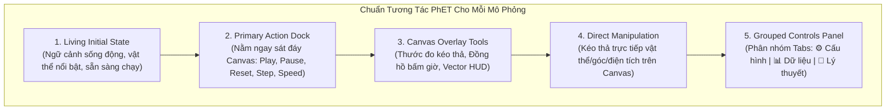

# ĐẶC TẢ TRẢI NGHIỆM NGƯỜI DÙNG (UX SPECIFICATION)
## Chuẩn Hóa 27 Bài Thí Nghiệm Vật Lý Đại Cương 1 & 2 Theo Phong Cách PhET Interactive Simulations
### Dự án: **LP.VirtualLab – Phòng Thí Nghiệm Vật Lý Ảo Tương Tác**
**Tác giả sáng lập:** Lê Ngọc Phú (VNU - Trường Đại học Công nghệ, ĐHQGHN)  
**Tài liệu dành cho:** UI/UX Designer, Frontend Developer, Physics Engine Developer

---

## 1. TỔNG QUAN HIỆN TRẠNG & NGUYÊN NHÂN GỐC RỄ (ROOT CAUSE ANALYSIS)

### 1.1. Hiện trạng kiểm thử người dùng phản ánh
Người dùng phản ánh: *"Các thí nghiệm đều đang lỗi không có thí nghiệm, màn hình canvas đen xì, không thấy vật thể hay chuyển động ban đầu, không biết bấm nút ở đâu để chạy"*.

Kết quả khảo sát kỹ thuật toàn bộ 27 mô phỏng cho thấy:
1. **Thiếu cơ chế "Living Initial State" (Trạng thái sống động ban đầu):**
   - Nhiều thí nghiệm (`projectile`, `newton-friction`, `rotational-inertia`,...) khởi tạo với biến cờ `running = false` hoặc `paused = true`. Canvas render ở trạng thái tĩnh tuyệt đối.
   - Màu nền canvas sử dụng tone đen đậm/xanh sẫm tuyệt đối (`#071529` hoặc `#0b1120`), độ tương phản yếu, thiếu ánh sáng môi trường phòng thí nghiệm (Ambient lab lighting).
   - Tỷ lệ khung hình và tọa độ vật thể bị đẩy sát đáy canvas: Ví dụ ở bài Ném Xiên (`projectile`), khẩu pháo đặt tại `y = canvas.height - 70 = 390px`. Trên màn hình laptop thông thường (chiều cao viewport hạn chế), phần đáy canvas bị tràn ra ngoài khung nhìn (below the fold), người dùng chỉ nhìn thấy khoảng không gian tối thẫm phía trên và 3 dòng chú thích nhỏ ở góc trái.
2. **Thiếu Thanh điều khiển hành động chính (Primary Action Bar):**
   - **20 / 27 bài thí nghiệm hoàn toàn không có bất kỳ nút bấm điều khiển nào** (như [Chạy], [Tạm dừng], [Đặt lại]) ở khu vực Canvas.
   - **7 / 27 bài còn lại** bố trí các nút icon rất nhỏ (`[🔥 Bắn]`, `[🔄]`, `[⏸️]`) nhét vào góc phải thanh tiêu đề card trên cùng (`.canvas-actions`), tách biệt hoàn toàn khỏi tâm điểm chú ý của người dùng trên Canvas.
   - Không có nút [Bước tiếp (Step)] để quan sát từng bước thời gian $\Delta t$, không có nút điều chỉnh tốc độ mô phỏng (0.5x, 1x, 2x).
3. **Thiếu công cụ tương tác đo đạc trực quan trên Canvas:**
   - Người dùng không có thước đo kéo thả (Draggable Ruler), không có đồng hồ bấm giờ (Digital Stopwatch) di động, không có công tắc bật tắt vector trực tiếp trên Canvas. Toàn bộ số liệu chỉ hiển thị thụ động dạng text ở sidebar bên phải.
4. **Bảng điều khiển bên phải (Controls Panel) quá tải nhận thức:**
   - Toàn bộ thanh trượt (slider), thông số và lý thuyết trải dài thành một cột đơn điệu, không phân nhóm theo Tab hay Collapsible Card, khiến người dùng bị ngợp khi tìm kiếm tham số cần thay đổi.

---

## 2. CHUẨN THIẾT KẾ TƯƠNG TÁC PhET (COLORADO BOULDER INTERACTION STANDARD)

Mô phỏng PhET (PhET Interactive Simulations - Đại học Colorado Boulder) là chuẩn mực toàn cầu về giáo dục vật lý số. Để đạt chuẩn PhET, toàn bộ hệ thống LP.VirtualLab phải tuân thủ 5 nguyên tắc cốt lõi:



### 2.1. Nguyên tắc 1: Cơ chế "Living Initial State" (Trạng thái sống động tức thì)
Mọi thí nghiệm khi mở ra tuyệt đối **không được là màn hình tĩnh đen xì**:
- **Bầu không khí phòng thí nghiệm (Laboratory Atmosphere):** Thay thế nền đen đặc bằng nền dải gradient cao cấp:
  - *Chủ đề Tối (Dark Lab):* Nền gradient tỏa từ tâm `#132238` ra mép `#09121d` kèm lưới tọa độ nhẹ (`rgba(56, 189, 248, 0.08)`).
  - *Chủ đề Sáng (Light Lab):* Nền gradient `#f8fafc` ra `#f1f5f9` với lưới ô vuông kỹ thuật `#e2e8f0`.
- **Vật thể thí nghiệm nổi khối (High-affordance Apparatus):** Vật thể trung tâm (khẩu pháo, con lắc, thanh đòn bẩy, bình xilanh, điện tích) phải có kích thước tối thiểu từ 30px đến 80px, đổ bóng mềm (drop-shadow), viền sáng để nổi bật khỏi nền.
- **Hiệu ứng "Breathing / Idle Motion" hoặc "Ghost Preview":**
  - Trong bài ném xiên: Khi chưa bắn, hiển thị ngay **đường cong nét đứt bán trong suốt (Ghost trajectory)** mờ ảo biểu thị trước đường bay dự kiến theo góc hiện tại.
  - Trong con lắc/dao động: Mặc định mở ra là hệ **đang dao động nhẹ nhàng (Looping state)** hoặc con lắc bị kéo lệch góc $\alpha_0$ kèm bóng mờ dao động.
  - Trong chất khí / điện tích: Các hạt phân tử di chuyển nhẹ nhàng, các đường sức điện phát sáng xung quanh điện tích.

---

### 2.2. Nguyên tắc 2: Thanh điều khiển hành động chính (Primary Action Dock)
Thanh điều khiển chính được thiết kế dạng **Floating Pill Dock** đặt ngay sát dưới Canvas, canh giữa với độ hiển thị ưu tiên cao nhất:

```
+-----------------------------------------------------------------------------------+
|                                  CANVAS 720 x 460                                 |
|                                                                                   |
|                                                                                   |
+-----------------------------------------------------------------------------------+
|  [ 🔄 Đặt lại ]    [ ⏪ -5s ]    ( ▶ BẮT ĐẦU )    [ ⏩ Bước tiếp ]    [ ⚙️ 1.0x ▾ ] |
+-----------------------------------------------------------------------------------+
```

#### Chi tiết linh kiện trong Primary Action Dock:
1. **Nút Play/Pause Toggle [▶ / ⏸]:**
   - Vị trí: Chính giữa, kích thước lớn nhất ($\varnothing 52\text{px}$).
   - Màu sắc: Nền gradient Primary Cyan (`#0284c7` -> `#0369a1`), hover phát sáng glow `0 0 16px rgba(2, 132, 199, 0.5)`.
   - Trạng thái: Khi đang chạy, nút chuyển sang biểu tượng `⏸ Tạm dừng` (Màu hổ phách Amber `#f59e0b`).
   - Phím tắt bàn phím: **Spacebar** (Bật/Tắt tức thời).
2. **Nút Reset [🔄 Đặt lại]:**
   - Đưa mô phỏng về trạng thái khởi tạo $t = 0$, khôi phục tham số mặc định nhưng giữ nguyên chế độ khảo sát.
   - Phím tắt: **Phím R**.
3. **Nút Step Forward [⏩ Bước tiếp]:**
   - Khi đang Pause, bấm nút này mô phỏng sẽ tiến đúng 1 bước tích phân thời gian ($\Delta t = 0.02\text{s}$ hoặc $0.05\text{s}$). Giúp sinh viên đo tọa độ chính xác từng điểm để ghi vào báo cáo thực hành.
   - Phím tắt: **Phím dấu chấm (.)** hoặc **Mũi tên phải (→)**.
4. **Bộ chọn tốc độ mô phỏng [Tốc độ: 0.5x | 1.0x | 2.0x]:**
   - Giúp làm chậm các hiện tượng chuyển động nhanh (như va chạm đàn hồi, tia khúc xạ, tán xạ Rutherford) hoặc đẩy nhanh các chu trình chậm (chu trình Carnot, nạp xả tụ điện).
5. **Nút Đoạn lặp / Tua lại [⏪ Tua lại 5s]:** (Áp dụng cho các bài động học, sóng, rơi tự do).

---

### 2.3. Nguyên tắc 3: Bộ công cụ đo trực quan trên Canvas (Canvas Overlay Tools)
Tất cả các đại lượng vật lý phải đo được trực tiếp ngay trên hiện trường:
- **📏 Thước đo di động (Interactive Tape Measure / Ruler):**
  - Một thanh thước bán trong suốt có thể kéo thả bất kỳ đâu trên Canvas.
  - Có 2 đầu chốt (Anchor A & Anchor B) kéo dài thu ngắn và xoay được theo phương bất kỳ, tự động hiện khoảng cách: ví dụ `$L = 45.2\text{ cm}$` hoặc `$d = 1.25\text{ m}$`.
- **⏱ Đồng hồ bấm giờ điện tử (Digital Floating Stopwatch):**
  - Hộp đồng hồ nhỏ gọn nằm ở góc Canvas, có thể kéo thả di chuyển.
  - Hiển thị: `00:00.00` với 2 nút: `[Start/Stop]` và `[Reset]`. Có cơ chế kích hoạt tự động theo cổng quang điện (Photogate timer).
- **🧭 HUD Vector & Lực (Force & Velocity Vector Display):**
  - Checkbox chọn hiển thị trên Canvas:
    - `☑️ Hiện Vector Vận tốc` $\vec{v}$ (Màu xanh lục `#22c55e`).
    - `☑️ Hiện Vector Lực` $\vec{F}$ (Màu đỏ `#ef4444`).
    - `☑️ Hiện Thành phần tọa độ` $(v_x, v_y)$ hoặc $(F_x, F_y)$ nét đứt.
    - `☑️ Hiện Trị số kèm nhãn` (Values & Labels).

---

### 2.4. Nguyên tắc 4: Bong bóng hướng dẫn nhanh (Canvas Quick Guide Callout)
- Khi mở bất kỳ thí nghiệm nào, một thẻ hướng dẫn nổi (Floating pill) xuất hiện nhẹ nhàng ở góc trên Canvas:
  > *"💡 Kéo nòng pháo để chỉnh góc bắn, sau đó bấm **[▶ Bắt đầu]** để phóng viên đạn!"*
- Tự động mờ dần sau 6 giây hoặc biến mất ngay khi người dùng chạm chuột vào Canvas.
- Góc phải Canvas luôn có nút icon tròn `[?]` nhỏ để gọi lại hướng dẫn thao tác bất cứ lúc nào.

---

### 2.5. Nguyên tắc 5: Tái cấu trúc bảng điều khiển bên phải (Grouped Controls Panel)
Thay vì cuộn dọc một trang dài, bảng bên phải chia làm 3 Tab chuyên biệt:
- **Tab 1: ⚙️ Tham số (Parameters):**
  - Chứa các thanh trượt slider kèm **ô nhập số trực tiếp (Editable Number Input)** để người dùng có thể kéo nhanh hoặc gõ chính xác số đo lý thuyết.
  - Mọi giá trị đều có đơn vị SI chuẩn mực: $\text{m/s}$, $\text{rad/s}$, $\text{kg}$, $\text{N}$, $\text{J}$, $\text{K}$, $\text{V}$, $\text{A}$, $\mu\text{F}$, $\text{nm}$.
- **Tab 2: 📊 Dữ liệu & Đồ thị (Data & Live Plot):**
  - Các card hiển thị số liệu tức thời dạng đồng hồ đo (Digital Gauges / Metric badges).
  - Đồ thị nhỏ (Mini-chart) vẽ thời gian thực: $x(t)$, $v(t)$, $P-V$, $I-U$,...
- **Tab 3: 📝 Thực hành & Công thức (Lab Guide & Formulas):**
  - Công thức KaTeX chuẩn mực.
  - Các câu hỏi trắc nghiệm kiểm chứng (Concept Checkpoints) để người học tự kiểm tra hiểu biết.

---

## 3. BẢNG ĐẶC TẢ CHI TIẾT UX CHO 27 BÀI THÍ NGHIỆM

Sau đây là đặc tả chi tiết cho từng bài thí nghiệm, định nghĩa chính xác:
1. Trạng thái sống động ban đầu (**Living Initial State**).
2. Thanh điều khiển chính (**Primary Action Dock**).
3. Công cụ trực quan trên Canvas (**Canvas Overlay Tools**).
4. Phân nhóm điều khiển bên phải (**Grouped Controls Panel**).
5. Tương tác trực tiếp trên Canvas (**Direct Canvas Manipulation**).

---

### PHẦN I: VẬT LÝ ĐẠI CƯƠNG 1 (13 BÀI)

#### Bài 1: Chuyển Động Ném Xiên & Ném Ngang (`projectile`)
- **Living Initial State:**
  - Khẩu pháo hiện đại tỷ lệ lớn (dài 45px, rộng 18px) đặt vững chắc trên bệ phóng tại $(x = 80, y = 370)$.
  - **Đường nét đứt vàng óng (Ghost Trajectory)** vẽ sẵn trước toàn bộ quỹ đạo lý thuyết theo góc $\alpha_0 = 45^\circ$ và $v_0 = 25\text{ m/s}$.
  - Một hồng tâm đích (Bulls-eye Target) đặt ở mặt đất tại điểm rơi lý thuyết $x = R_{\text{max}}$.
  - Nòng pháo có thước đo độ cong hiển thị rõ số góc `$45^\circ$`.
- **Primary Action Dock:**
  - `[ 🔄 Đặt lại ]` | `( 🔥 BẮN / ⏸ DỪNG )` | `[ ⏩ Bước tiếp (0.02s) ]` | `[ ⏱ Tốc độ: 0.5x | 1.0x | 2.0x ]`.
- **Canvas Overlay Tools:**
  - Thước dây kéo thả đo tầm xa $R$ và độ cao cực đại $H_{\text{max}}$.
  - Đồng hồ bấm giờ đo thời gian bay $t_{\text{flight}}$.
  - Checkbox HUD: `[☑️ Vector vận tốc v]`, `[☑️ Vector gia tốc g]`, `[☑️ Quỹ đạo lý thuyết]`.
- **Direct Manipulation:**
  - Kéo chuột trực tiếp vào đầu nòng pháo để thay đổi góc bắn $\alpha$ linh hoạt.
  - Kéo thanh nâng bệ phóng để chỉnh độ cao ban đầu $h_0$.
  - Kéo hồng tâm đích di chuyển trên mặt đất.

#### Bài 2: Định Luật Newton & Ma Sát Trên Mặt Phẳng Nghiêng (`newton-friction`)
- **Living Initial State:**
  - Nêm mặt phẳng nghiêng màu xám kim loại sang trọng với góc dốc $\alpha = 25^\circ$.
  - Vật khối lượng $m = 5\text{ kg}$ đặt sẵn giữa dốc, có 4 vector lực vẽ sẵn nổi bật: Trọng lực $\vec{P}$ (đỏ), Phản lực $\vec{N}$ (lam), Lực kéo $\vec{F}_{\text{kéo}}$ (xanh lá), Lực ma sát $\vec{F}_{\text{ms}}$ (vàng).
  - Trạng thái ban đầu: Vật đứng yên cân bằng tĩnh, có nhãn trạng thái nổi: `Đang cân bằng tĩnh (F_ms nghỉ = P·sinα)`.
- **Primary Action Dock:**
  - `[ 🔄 Đặt lại ]` | `( ▶ THẢ VẬT / ⏸ TẠM DỪNG )` | `[ ⏩ Bước tiếp ]` | `[ ⏱ 1.0x ]`.
- **Canvas Overlay Tools:**
  - Biểu đồ phân tích lực tự do (Free-Body Diagram) hiển thị ở góc trên Canvas.
  - Thước đo chiều dài quãng đường trượt $s$.
- **Direct Manipulation:**
  - Kéo đỉnh nêm lên/xuống để đổi góc nghiêng $\alpha$.
  - Kéo trực tiếp vào vật để đặt vị trí xuất phát.

#### Bài 3: Chuyển Động Tròn Đều & Lực Hướng Tâm (`circular-motion`)
- **Living Initial State:**
  - Vật $m$ nối vào tâm quay bằng sợi dây căng màu xanh sáng, đang quay đều với vận tốc góc $\omega_0 = 3\text{ rad/s}$.
  - Vệt sáng phát quang (Glow particle trail) vẽ nên đường tròn quỹ đạo.
  - Vector vận tốc $\vec{v}$ (tiếp tuyến) và vector lực hướng tâm $\vec{F}_{\text{ht}}$ (hướng tâm) chuyển động mượt mà.
- **Primary Action Dock:**
  - `[ 🔄 Đặt lại ]` | `( ⏸ TẠM DỪNG / ▶ TIẾP TỤC )` | `[ ✂️ CẮT DÂY ]` | `[ ⏱ 1.0x ]`.
- **Canvas Overlay Tools:**
  - Nút bấm `[✂️ Cắt Dây]`: Khi bấm, dây biến mất tức thì, vật bay văng ra ngoài theo tiếp tuyến quán tính (Định luật 1 Newton), để lại đường tiếp tuyến nét đứt minh họa trực quan.
- **Direct Manipulation:**
  - Kéo thả bán kính $r$ của quỹ đạo trực tiếp trên Canvas.

#### Bài 4: Va Chạm & Bảo Toàn Động Lượng (`collision`)
- **Living Initial State:**
  - Đệm không khí nằm ngang (Air Track) không ma sát.
  - 2 quả cầu / xe trượt: Xe 1 (Đỏ, $m_1 = 2\text{ kg}, v_1 = +3\text{ m/s}$), Xe 2 (Lam, $m_2 = 1.5\text{ kg}, v_2 = -2\text{ m/s}$) đang chuyển động chậm lại gần nhau để chuẩn bị va chạm.
  - Phía trên mỗi xe có thanh hiển thị vector động lượng $\vec{p} = m\vec{v}$.
- **Primary Action Dock:**
  - `[ 🔄 Đặt lại ]` | `( ⏸ TẠM DỪNG / ▶ CHẠY )` | `[ ⏩ Bước tiếp ]` | `[ ⏱ Tốc độ: 0.25x (Siêu chậm) | 1.0x ]`.
- **Canvas Overlay Tools:**
  - Đồ thị cột (Bar Chart) động lượng toàn phần $P_{\text{total}} = p_1 + p_2$ và tổng động năng $E_k$ trước và sau va chạm.
- **Direct Manipulation:**
  - Kéo đầu mũi tên vận tốc trên mỗi xe để gán vận tốc đầu tùy ý trước khi bấm Chạy.

#### Bài 5: Bảo Toàn Cơ Năng - Đường Trượt Skate Park (`energy-skate`)
- **Living Initial State:**
  - Máng trượt parabol bằng thép uốn lượn đẹp mắt.
  - Vận động viên trượt ván (Skater) đang lướt qua lại êm ái giữa 2 mép máng.
  - Ngay cạnh Skater có biểu đồ cột động năng ($E_k$ - lam), thế năng ($E_p$ - xanh lá) và cơ năng toàn phần ($E_{\text{total}}$ - vàng) chuyển hóa nhịp nhàng.
- **Primary Action Dock:**
  - `[ 🔄 Đặt lại ]` | `( ⏸ TẠM DỪNG / ▶ CHẠY )` | `[ ⏩ Bước tiếp ]` | `[ ⏱ 1.0x ]`.
- **Canvas Overlay Tools:**
  - Vạch đo độ cao $h$ và thước đo độ cao chuẩn quy ước mốc thế năng ($y = 0$).
  - Nút bật/tắt ma sát: `[ ☑️ Bật ma sát trượt ]`.
- **Direct Manipulation:**
  - Dùng chuột nhấc Skater thả vào bất kỳ điểm nào trên đường ray để thử nghiệm bảo toàn cơ năng.

#### Bài 6: Cân Bằng Vật Rắn & Momen Lực - Đòn Bẩy (`balancing-act`)
- **Living Initial State:**
  - Thanh đòn bẩy nằm ngang đặt trên điểm tựa tam giác vững chắc, có vạch chia khoảng cách rõ ràng từ $-8\text{m}$ đến $+8\text{m}$.
  - 2 quả cân mẫu ($5\text{kg}$ ở vị trí $-4\text{m}$, $10\text{kg}$ ở vị trí $+2\text{m}$) cân bằng hoàn hảo theo định luật momen: $5 \times 4 = 10 \times 2 = 20\text{ N}\cdot\text{m}$.
  - Có 2 mũi tên vector momen quay chiều kim đồng hồ $\curvearrowright$ và ngược chiều kim đồng hồ $\curvearrowleft$.
- **Primary Action Dock:**
  - `[ 🔄 Đặt lại ]` | `[ 🔓 Mở chốt cân bằng / 🔒 Khóa chốt ]` | `[ ⚖️ Kiểm tra cân bằng ]`.
- **Direct Manipulation:**
  - Kéo thả các quả cân ($2\text{kg}, 5\text{kg}, 10\text{kg}, 20\text{kg}$) từ khay để lên các mấu chốt của thanh bập bênh.

#### Bài 7: Chuyển Động Quay & Momen Quán Tính (`rotational-inertia`)
- **Living Initial State:**
  - Vòng quay / đĩa tròn đang quay quanh trục cố định với vận tốc góc $\omega = 4\text{ rad/s}$.
  - 2 quả nặng đặt đối xứng trên thanh trượt của đĩa.
  - Đồ thị radar hiển thị momen quán tính $I = \sum m_i r_i^2$ và momen động lượng $L = I\omega$.
- **Primary Action Dock:**
  - `[ 🔄 Đặt lại ]` | `( ⏸ TẠM DỪNG / ▶ CHẠY )` | `[ ⏱ 1.0x ]`.
- **Direct Manipulation:**
  - Kéo 2 quả nặng trượt vào sát trục quay hoặc ra mép ngoài để quan sát hiệu ứng nghệ sĩ trượt băng nghệ thuật (khi $I$ giảm thì $\omega$ tăng vọt tức thì để bảo toàn $L$).

#### Bài 8: Khí Lý Tưởng P-V-T (`gas-properties`)
- **Living Initial State:**
  - Xilanh chứa khí kín bằng thủy tinh trong suốt, bên trong có 100 phân tử khí chuyển động Brown hỗn loạn, va đập vào thành xilanh phát ra xung lực.
  - Đồng hồ áp suất (Pressure Gauge) gắn trên đỉnh dao động quanh giá trị $14.6\text{ atm}$.
  - Nhiệt kế gắn bên hông chỉ $300\text{ K}$.
  - Đáy bình có lò sưởi / xô đá có thể gạt nhiệt độ.
- **Primary Action Dock:**
  - `[ 🔄 Đặt lại ]` | `( ⏸ ĐÓNG BĂNG HẠT / ▶ TIẾP TỤC )` | `[ ⏩ Bước tiếp ]` | `[ 🔥 Nung nóng / ❄️ Làm lạnh ]`.
- **Canvas Overlay Tools:**
  - Nút bơm thêm phân tử khí (Bơm tay PhET).
  - Thước đo thể tích (chiều dài buồng xilanh).
- **Direct Manipulation:**
  - Cầm cán piston kéo sang trái/phải để nén hoặc giãn thể tích khí $V$.

#### Bài 9: Động Học Phân Tử & Maxwell-Boltzmann (`maxwell-boltzmann`)
- **Living Initial State:**
  - Màn hình chia làm 2 phần: Bên trái là buồng 120 phân tử khí chuyển động nhiệt hỗn loạn (hạt tốc độ cao màu đỏ, hạt tốc độ thấp màu xanh).
  - Bên phải là đồ thị phân bố vận tốc thực tế $f(v)$ so sánh với đường cong lý thuyết Maxwell-Boltzmann mượt mà.
  - Vạch đánh dấu vận tốc trung bình $v_{\text{tb}}$ và vận tốc căn quân phương $v_{\text{rms}}$.
- **Primary Action Dock:**
  - `[ 🔄 Đặt lại mẫu ]` | `( ⏸ TẠM DỪNG / ▶ CHẠY )` | `[ ⏱ 1.0x ]`.
- **Controls Panel:**
  - Slider nhiệt độ $T$ ($100\text{ K} - 1000\text{ K}$) và khối lượng mol phân tử khí ($He, N_2, Ar, Xe$).

#### Bài 10: Quá Trình Nhiệt Động & Chu Trình Carnot (`carnot-cycle`)
- **Living Initial State:**
  - Đồ thị $P-V$ biểu diễn chu trình khép kín gồm 4 giai đoạn (Giãn đẳng nhiệt $\rightarrow$ Giãn đoạn nhiệt $\rightarrow$ Nén đẳng nhiệt $\rightarrow$ Nén đoạn nhiệt).
  - Một điểm trạng thái sáng rực rỡ đang chạy tuần hoàn trên chu trình.
  - Bên cạnh là mô hình động cơ nhiệt với nguồn nóng $T_H$, nguồn lạnh $T_C$, dòng nhiệt $Q_H$, $Q_C$ và công sinh ra $W$.
- **Primary Action Dock:**
  - `[ 🔄 Chu trình mới ]` | `( ⏸ TẠM DỪNG / ▶ CHẠY CHU TRÌNH )` | `[ ⏩ Bước sang giai đoạn tiếp ]` | `[ ⚙️ 1.0x ]`.
- **Canvas Overlay Tools:**
  - Diện tích chu trình được tô màu bán trong suốt tương ứng với công thực hiện $W = \oint P dV$.

#### Bài 11: Dao Động Điều Hòa - Con Lắc Lò Xo & Con Lắc Đơn (`harmonic`)
- **Living Initial State:**
  - Nửa trái canvas: Con lắc lò xo treo quả nặng $m = 2\text{ kg}$ đang dao động điều hòa êm ái qua vị trí cân bằng.
  - Nửa phải canvas: Đồ thị li độ theo thời gian $x(t) = A\cos(\omega t + \varphi)$ cuộn sóng sin mượt mà theo thời gian thực.
  - Vạch đánh dấu vị trí cân bằng (VTCB), biên dương $+A$ và biên âm $-A$.
- **Primary Action Dock:**
  - `[ 🔄 Đặt lại ]` | `( ⏸ TẠM DỪNG / ▶ CHẠY )` | `[ ⏩ Bước tiếp (0.02s) ]` | `[ ⏱ 0.5x | 1.0x ]`.
- **Canvas Overlay Tools:**
  - Thước đo li độ $x$, đồng hồ bấm giờ đo chu kỳ $T$.
  - Radio chọn nhanh: `(o) Con lắc lò xo` | `( ) Con lắc đơn`.
- **Direct Manipulation:**
  - Cầm quả nặng kéo lệch khỏi VTCB rồi thả tay để kích thích dao động.

#### Bài 12: Hiện Tượng Cộng Hưởng Cơ Học (`resonance`)
- **Living Initial State:**
  - Hệ quả nặng gắn lò xo có cản nhớt (giảm chấn) nối với một động cơ kích thích tuần hoàn.
  - Đang dao động ở chế độ xác lập.
  - Đồ thị đáp ứng biên độ theo tần số cưỡng bức $A(\Omega)$ vẽ đường cong cộng hưởng Lorentz với đỉnh nhọn tại $\Omega = \omega_0$.
- **Primary Action Dock:**
  - `[ 🔄 Quét tần số ]` | `( ⏸ TẠM DỪNG / ▶ CHẠY )` | `[ ⏩ Bước tiếp ]`.
- **Direct Manipulation:**
  - Kéo thanh trượt tần số ngoại lực $\Omega$ lại gần tần số riêng $\omega_0$ để quan sát biên độ vọt lên cực đại (Hiện tượng cộng hưởng).

#### Bài 13: Sóng Dừng & Sóng Âm - Hiệu Ứng Doppler (`waves-standing`)
- **Living Initial State:**
  - Sợi dây đàn hồi căng ngang đang rung tạo ra sóng dừng với 3 bụng sóng và 4 nút sóng rõ nét.
  - Các phần tử dây chuyển động tuần hoàn phát sáng.
  - Đánh dấu rõ vị trí Nút sóng (Node) và Bụng sóng (Antinode).
- **Primary Action Dock:**
  - `[ 🔄 Đặt lại ]` | `( ⏸ TẠM DỪNG / ▶ CHẠY )` | `[ ⏩ Bước tiếp ]` | `[ ⏱ 0.5x | 1.0x ]`.
- **Canvas Overlay Tools:**
  - Thước đo bước sóng $\lambda$.
  - Chuyển chế độ: `Sóng Dừng trên dây` | `Giao thoa 2 nguồn sóng nước` | `Hiệu ứng Doppler nguồn âm di động`.

---

### PHẦN II: VẬT LÝ ĐẠI CƯƠNG 2 (14 BÀI)

#### Bài 14: Định Luật Coulomb & Điện Trường Tĩnh (`coulomb-field`)
- **Living Initial State:**
  - Một điện tích dương $q_1 = +2\text{ nC}$ (đỏ rực rỡ) và một điện tích âm $q_2 = -2\text{ nC}$ (xanh dương sáng) đặt cách nhau $2\text{ m}$.
  - Lưới vector cường độ điện trường $\vec{E}$ dày dặn, mũi tên phát quang chỉ hướng từ $q_1$ sang $q_2$.
  - Một đầu dò điện thế (Sensor Probe $V$) đặt tại trung điểm hiển thị `$V = 0.0\text{ V}$`.
- **Primary Action Dock:**
  - `[ 🔄 Đặt lại ]` | `[ ➕ Thêm điện tích + ]` | `[ ➖ Thêm điện tích - ]` | `[ 🗑️ Xóa hết ]`.
- **Canvas Overlay Tools:**
  - Cảm biến đo điện trường và điện thế di động: Kéo đầu dò đi tới đâu hiện giá trị $E (\text{V/m})$ và $V (\text{V})$ tới đó.
  - Thước dây đo khoảng cách giữa 2 điện tích.
- **Direct Manipulation:**
  - Kéo thả các điện tích tự do khắp mặt phẳng để quan sát sự biến dạng tức thời của lưới điện trường.

#### Bài 15: Tụ Điện & Điện Dung (`capacitor`)
- **Living Initial State:**
  - Mô hình tụ điện phẳng 2 bản cực kim loại nối vào nguồn pin DC $1.5\text{ V}$.
  - Bản trên tích điện dương $(++++)$, bản dưới tích điện âm $(----)$.
  - Tấm điện môi (Dielectric Slab) màu ngọc bích đặt sẵn một phần giữa 2 bản cực.
  - Vôn kế đo hiệu điện thế và đồng hồ đo điện dung $C$, năng lượng điện trường $W$.
- **Primary Action Dock:**
  - `[ 🔄 Ngắt nguồn ]` | `[ 💡 PHÓNG ĐIỆN QUA BÓNG ĐÈN ]` | `[ 🔋 Nạp điện ]`.
- **Direct Manipulation:**
  - Cầm tấm điện môi kéo ra/vào giữa 2 bản cực để thấy điện dung $C$ tăng vọt khi đưa điện môi vào.
  - Kéo thay đổi diện tích bản tụ $A$ và khoảng cách giữa 2 bản $d$.

#### Bài 16: Định Luật Ohm & Mạch Điện Một Chiều DC (`circuit-dc`)
- **Living Initial State:**
  - Sơ đồ mạch điện khép kín gồm nguồn pin ($E, r$), biến trở $R$, ampe kế và bóng đèn đang sáng.
  - Các hạt electron màu xanh chuyển động chạy vòng quanh mạch theo quy tắc dòng điện.
  - Đèn phát sáng với vầng hào quang tỉ lệ thuận với công suất $P = I^2 R$.
- **Primary Action Dock:**
  - `[ 🔄 Đặt lại ]` | `[ 🔌 ĐÓNG / NGẮT KHÓA K ]` | `[ ⚡ Đảo cực nguồn ]`.
- **Canvas Overlay Tools:**
  - Vôn kế (2 que đo đỏ/đen) và Ampe kế kẹp dòng kéo thả tự do đo tại bất kỳ nhánh nào của mạch.

#### Bài 17: Từ Trường & Lực Từ Lorentz (`lorentz-force`)
- **Living Initial State:**
  - Vùng từ trường đều $\vec{B}$ vuông góc với mặt phẳng hình vẽ (ký hiệu dấu cộng $\otimes$ màu xanh ngọc).
  - Một hạt mang điện tích $q = +e$ đang bay uốn cong thành quỹ đạo tròn hoàn hảo dưới tác dụng của lực từ Lorentz $\vec{F}_L = q(\vec{v} \times \vec{B})$.
  - Vector $\vec{v}$ (tiếp tuyến) và vector $\vec{F}_L$ (hướng tâm) chuyển động đồng bộ.
- **Primary Action Dock:**
  - `[ 🔄 Bắn lại hạt ]` | `( ⏸ TẠM DỪNG / ▶ CHẠY )` | `[ ⏩ Bước tiếp ]` | `[ ⏱ 0.5x | 1.0x ]`.
- **Direct Manipulation:**
  - Kéo góc phóng và vận tốc hạt ban đầu $\vec{v}_0$ để quan sát quỹ đạo tròn hoặc xoắn ốc (khi có thành phần vận tốc song song với $\vec{B}$).

#### Bài 18: Hiện Tượng Cảm Ứng Điện Từ Faraday & Lenz (`faraday`)
- **Living Initial State:**
  - Cuộn dây Solenoid nhiều vòng nối với một điện kế nhạy galvanometer ở giữa.
  - Một thanh nam châm thẳng với 2 cực Bắc (N - đỏ) và Nam (S - lam) kèm các đường sức từ 3D bao quanh.
  - Nam châm đang đung đưa nhẹ qua lại miệng cuộn dây, kim điện kế lập tức lệch sang trái/phải hiển thị dòng điện cảm ứng $i_c$.
- **Primary Action Dock:**
  - `[ 🔄 Về giữa ]` | `( ⏸ DỪNG TỰ ĐỘNG / ▶ CHUYỂN ĐỘNG TUẦN HOÀN )` | `[ 🧲 Đảo cực nam châm ]`.
- **Direct Manipulation:**
  - Cầm chuột nắm thanh nam châm đâm nhanh/chậm qua cuộn dây để cảm nhận trực quan tốc độ biến thiên từ thông $\frac{d\Phi}{dt}$.

#### Bài 19: Mạch Điện Xoay Chiều A.C. RLC (`rlc-ac`)
- **Living Initial State:**
  - Nửa trái canvas: Đồ thị dao động sóng sin hiển thị đồng thời điện áp tức thời $u(t)$ (màu đỏ) và dòng điện tức thời $i(t)$ (màu xanh) lệch pha góc $\varphi$.
  - Nửa phải canvas: Giản đồ vector quay Fresnel chuẩn mực với các vector $\vec{U}_R, \vec{U}_L, \vec{U}_C$ và vector tổng $\vec{U}$.
- **Primary Action Dock:**
  - `[ 🔄 Tần số cộng hưởng ]` | `( ⏸ TẠM DỪNG / ▶ CHẠY )` | `[ ⏩ Bước tiếp ]`.
- **Canvas Overlay Tools:**
  - Nút bấm nhanh: `[ ⚡ Đặt vào trạng thái Cộng hưởng điện (ωL = 1/ωC) ]`.

#### Bài 20: Khúc Xạ & Phản Xạ Toàn Phần Snell (`snell-refraction`)
- **Living Initial State:**
  - Đèn laser phát ra chùm sáng sắc nét từ môi trường 1 (Không khí, $n_1 = 1.0$) tới mặt phân cách với môi trường 2 (Nước, $n_2 = 1.33$).
  - Tia khúc xạ bẻ gãy tuân theo định luật Snell $n_1 \sin i = n_2 \sin r$. Tia phản xạ mờ hơn có cường độ bảo toàn năng lượng.
  - Vòng tròn thước đo góc quang học (Protractor) đặt ngay tại pháp tuyến với vạch chia độ rõ ràng.
- **Primary Action Dock:**
  - `[ 🔄 Góc chuẩn 45° ]` | `[ 🔦 Bật/Tắt Laser ]` | `[ 🌈 Chọn nguồn sáng: Đơn sắc / Ánh sáng trắng ]`.
- **Canvas Overlay Tools:**
  - Cảm biến đo cường độ sáng (%) cho cả tia phản xạ và tia khúc xạ.
- **Direct Manipulation:**
  - Nắm thân đèn laser xoay góc tới $i$ từ $0^\circ$ đến $90^\circ$, quan sát hiện tượng phản xạ toàn phần khi $i > i_{\text{gh}}$.

#### Bài 21: Quang Hình: Thấu Kính Mỏng & Gương (`geometric-optics`)
- **Living Initial State:**
  - Trục chính quang học nằm ngang, thấu kính hội tụ tiêu cự $f = +15\text{ cm}$ đặt tại tâm.
  - Vật sáng mũi tên $AB$ (màu cam) đặt ngoài khoảng $2f$.
  - Ảnh thật $A'B'$ (ngược chiều, màu xanh) hiển thị rõ nét trên màn hứng.
  - 3 tia sáng đặc biệt (tia song song trục chính qua tiêu điểm $F'$, tia qua quang tâm $O$ truyền thẳng, tia qua tiêu điểm vật $F$ ló song song) vẽ bằng 3 màu khác biệt.
- **Primary Action Dock:**
  - `[ 🔄 Đặt lại ]` | `[ 🔍 Đổi thấu kính: Hội tụ / Phân kỳ / Gương cầu ]`.
- **Direct Manipulation:**
  - Kéo trực tiếp đỉnh vật sáng $A$ để thay đổi khoảng cách $d$ và chiều cao vật $h$.
  - Kéo tiêu điểm $F, F'$ để đổi độ tụ $D$ của thấu kính.

#### Bài 22: Giao Thoa Ánh Sáng Young & Vân Newton (`young-interference`)
- **Living Initial State:**
  - Sơ đồ thí nghiệm khe Young: Nguồn laser phát sáng qua 2 khe hẹp $S_1, S_2$.
  - Trên màn quan sát bên phải hiển thị dải vân giao thoa thực tế (các vạch sáng tối xen kẽ màu theo bước sóng $\lambda = 532\text{ nm}$ xanh lá).
  - Đồ thị phân bố cường độ sáng $I(x) = 4I_0 \cos^2\left(\frac{\pi a x}{\lambda D}\right)$ vẽ chuẩn mực bên cạnh dải vân.
- **Primary Action Dock:**
  - `[ 🔄 Đặt lại ]` | `[ 💡 Chuyển chế độ: Vân Young / Vân tròn Newton ]`.
- **Canvas Overlay Tools:**
  - Thước kẹp đo khoảng vân $i$ với độ chính xác micromet.

#### Bài 23: Nhiễu Xạ Ánh Sáng Khe Hẹp & Đĩa Airy (`diffraction`)
- **Living Initial State:**
  - Chùm sáng qua một khe hẹp bề rộng $a$.
  - Màn hứng hiển thị hình ảnh nhiễu xạ Fraunhofer với cực đại trung tâm rộng gấp đôi và sáng rực rỡ, hai bên là các cực đại phụ mờ dần.
  - Đồ thị hàm $\text{sinc}^2(\beta)$ vẽ đối sánh trực tiếp.
- **Primary Action Dock:**
  - `[ 🔄 Khe chuẩn 0.1mm ]` | `[ ⚪ Đổi khe: Khe hẹp thẳng / Lỗ tròn (Đĩa Airy) ]`.
- **Direct Manipulation:**
  - Kéo mép khe hẹp trực tiếp trên canvas để quan sát hiện tượng khe càng hẹp thì vùng nhiễu xạ càng xòe rộng.

#### Bài 24: Phân Cực Ánh Sáng Malus & Brewster (`polarization`)
- **Living Initial State:**
  - Nguồn sáng tự nhiên truyền qua Kính phân cực 1 (Polarizer) và Kính phân tích 2 (Analyzer) góc lệch $\theta = 45^\circ$.
  - Chùm tia sau kính 2 mờ đi theo định luật Malus $I = I_0 \cos^2\theta$.
  - Đĩa hiển thị quang học trực quan mô phỏng dao động của vector điện trường $\vec{E}$.
- **Primary Action Dock:**
  - `[ 🔄 Đặt lại 0° ]` | `[ 📐 Đặt góc vuông 90° (Tối hoàn toàn) ]` | `[ 🌊 Góc Brewster ]`.
- **Direct Manipulation:**
  - Xoay trực tiếp đĩa kính phân tích bằng chuột để cảm nhận sự thay đổi cường độ sáng liên tục.

#### Bài 25: Hiện Tượng Quang Điện Ngoài (`photoelectric`)
- **Living Initial State:**
  - Ống chân không bằng thủy tinh trong suốt với bản Catot (Natri, $A = 2.36\text{ eV}$) và Anot.
  - Chùm photon bước sóng $\lambda = 400\text{ nm}$ (tím) chiếu liên tục vào Catot làm bứt ra chùm quang electron màu xanh bay sang Anot.
  - Nguồn điện một chiều $U$ gắn trên mạch hiển thị đồng hồ milli-ampe kế có dòng $I > 0$.
- **Primary Action Dock:**
  - `[ 🔄 Đặt lại ]` | `( ⏸ TẠM DỪNG / ▶ CHẠY )` | `[ 🛑 Tìm hiệu điện thế hãm Uh ]`.
- **Canvas Overlay Tools:**
  - Đồ thị đặc tuyến Vôn - Ampe $I(U)$ vẽ thời gian thực.
- **Direct Manipulation:**
  - Trượt nguồn điện áp $U$ sang âm để tìm chính xác điện áp hãm $U_h$ làm triệt tiêu hoàn toàn dòng quang điện ($I = 0$).

#### Bài 26: Bức Xạ Vật Đen Wien & Stefan-Boltzmann (`blackbody`)
- **Living Initial State:**
  - Bên trái: Quả cầu vật đen nung nóng ở nhiệt độ bề mặt Mặt Trời $T = 5800\text{ K}$, phát sáng màu trắng chói lòa.
  - Bên phải: Đồ thị phổ bức xạ Planck $u(\lambda, T)$ với đỉnh cực đại nằm đúng vùng ánh sáng nhìn thấy ($\lambda_{\text{max}} \approx 500\text{ nm}$). Dải màu quang phổ cầu vồng được tô nền trực tiếp dưới diện tích đường cong.
- **Primary Action Dock:**
  - `[ ☀️ Đặt nhiệt độ Mặt Trời (5800K) ]` | `[ 💡 Đèn dây tóc (3000K) ]` | `[ 🌍 Trái Đất (300K) ]`.
- **Direct Manipulation:**
  - Kéo thanh nhiệt độ $T$ để quan sát định luật Wien: Nhiệt độ càng cao, đỉnh phổ càng dịch chuyển về phía sóng ngắn (từ đỏ sang lam).

#### Bài 27: Mô Hình Nguyên Tử Bohr & Tán Xạ Rutherford (`bohr-rutherford`)
- **Living Initial State:**
  - *Chế độ Bohr:* Hạt nhân Proton ở tâm, electron đang quay tròn êm ả trên quỹ đạo dừng $n = 3$.
  - Sơ đồ mức năng lượng $E_1, E_2, E_3, E_4$ hiển thị rõ bên cạnh.
  - Khi người dùng bấm kích thích hoặc nhảy mức, electron nhảy tức thì kèm một photon sóng phát xạ bắn vút ra ngoài mang năng lượng $\Delta E = h\nu$ với màu sắc tương ứng (Dãy Balmer / Lyman).
- **Primary Action Dock:**
  - `[ 🪐 Mô hình Bohr / 💥 Tán xạ Rutherford ]` | `[ ⚡ Nhảy về n=1 (Lyman) ]` | `[ 💡 Nhảy về n=2 (Balmer) ]`.
- **Direct Manipulation:**
  - Trong chế độ Rutherford: Bắn chùm hạt $\alpha$ xuyên qua lá vàng, quan sát một vài hạt bị tán xạ góc lớn do va chạm gần với hạt nhân đặc.

---

## 4. KIẾN TRÚC KỸ THUẬT & MÃ MẪU THÀNH PHẦN (COMPONENT CODE SPECIFICATION)

Để Frontend Developer và Physics Engine Developer hiện thực hóa chuẩn UX này một cách đồng bộ và nhanh chóng, dưới đây là đặc tả kiến trúc thành phần tái sử dụng.

### 4.1. Cấu trúc DOM chuẩn hóa của mỗi Section thí nghiệm
```html
<section id="{experiment-id}" class="section">
    <div class="experiment-layout">
        <!-- Khu vực Canvas & Điều khiển chính -->
        <div class="canvas-master-card">
            <div class="canvas-header">
                <div class="header-title-group">
                    <span class="exp-badge">{Môn học}</span>
                    <h2>{Tên thí nghiệm}</h2>
                </div>
                <div class="canvas-quick-tools">
                    <button class="tool-btn" data-tool="ruler" title="Bật/Tắt Thước đo">📏 Thước</button>
                    <button class="tool-btn" data-tool="stopwatch" title="Đồng hồ bấm giờ">⏱ Đồng hồ</button>
                    <button class="tool-btn" data-tool="help" title="Xem hướng dẫn nhanh">❓</button>
                </div>
            </div>

            <!-- Canvas Viewport với Overlay Container -->
            <div class="canvas-viewport">
                <canvas id="{canvas-id}" width="720" height="460"></canvas>
                
                <!-- On-Canvas Quick Guide Toast -->
                <div class="canvas-quick-guide" id="{exp}-guide">
                    <span class="guide-icon">💡</span>
                    <span class="guide-text">{Hướng dẫn tương tác 1 dòng}</span>
                    <button class="guide-close">&times;</button>
                </div>
            </div>

            <!-- PHET PRIMARY ACTION DOCK (Nổi bật sát đáy Canvas) -->
            <div class="primary-action-dock" id="{exp}-dock">
                <button class="dock-btn btn-reset" title="Đặt lại (Phím R)">
                    <span class="btn-icon">🔄</span>
                    <span class="btn-label">Đặt lại</span>
                </button>
                
                <button class="dock-btn btn-play-pause is-play" title="Bắt đầu / Tạm dừng (Phím Space)">
                    <span class="play-icon">▶</span>
                    <span class="btn-label">Bắt đầu</span>
                </button>
                
                <button class="dock-btn btn-step" title="Bước tiếp 1 khung hình (Phím .)">
                    <span class="btn-icon">⏩</span>
                    <span class="btn-label">Bước tiếp</span>
                </button>

                <div class="dock-speed-selector">
                    <span class="speed-label">Tốc độ:</span>
                    <button class="speed-opt" data-speed="0.5">0.5x</button>
                    <button class="speed-opt active" data-speed="1.0">1.0x</button>
                    <button class="speed-opt" data-speed="2.0">2.0x</button>
                </div>
            </div>
        </div>

        <!-- Bảng điều khiển nhóm bên phải (Tabbed Controls Panel) -->
        <div class="controls-panel">
            <div class="panel-tabs">
                <button class="tab-btn active" data-tab="params">⚙️ Cấu hình</button>
                <button class="tab-btn" data-tab="data">📊 Dữ liệu</button>
                <button class="tab-btn" data-tab="theory">📝 Lý thuyết</button>
            </div>

            <!-- Tab Content 1: Tham số & Slider có input số -->
            <div class="tab-content active" id="{exp}-tab-params">
                <!-- Group inputs with SI units -->
            </div>

            <!-- Tab Content 2: Dữ liệu đo đạc & Mini-Graph -->
            <div class="tab-content" id="{exp}-tab-data">
                <!-- Metrics and live telemetry -->
            </div>

            <!-- Tab Content 3: Công thức & Ý nghĩa -->
            <div class="tab-content" id="{exp}-tab-theory">
                <!-- KaTeX formulas -->
            </div>
        </div>
    </div>
</section>
```

---

### 4.2. CSS Quy chuẩn cho PhET Primary Action Dock
```css
/* ============================================================
   PhET PRIMARY ACTION DOCK - CHUẨN GIAO DIỆN HÀNH ĐỘNG CHÍNH
   ============================================================ */
.primary-action-dock {
    display: flex;
    align-items: center;
    justify-content: center;
    gap: 16px;
    padding: 14px 24px;
    background: linear-gradient(180deg, #1e293b 0%, #0f172a 100%);
    border-top: 2px solid rgba(56, 189, 248, 0.2);
    border-radius: 0 0 var(--radius) var(--radius);
    box-shadow: 0 8px 24px rgba(0, 0, 0, 0.4);
}

/* Nút Play/Pause Nổi Bật Trung Tâm */
.dock-btn.btn-play-pause {
    display: inline-flex;
    align-items: center;
    gap: 8px;
    padding: 10px 28px;
    font-size: 16px;
    font-weight: 700;
    color: #ffffff;
    background: linear-gradient(135deg, #0284c7 0%, #0369a1 100%);
    border: 2px solid #38bdf8;
    border-radius: 30px;
    cursor: pointer;
    box-shadow: 0 4px 14px rgba(2, 132, 199, 0.45);
    transition: all 0.2s cubic-bezier(0.4, 0, 0.2, 1);
}

.dock-btn.btn-play-pause:hover {
    transform: translateY(-2px) scale(1.03);
    box-shadow: 0 6px 20px rgba(56, 189, 248, 0.6);
    background: linear-gradient(135deg, #0369a1 0%, #0284c7 100%);
}

.dock-btn.btn-play-pause.is-running {
    background: linear-gradient(135deg, #d97706 0%, #b45309 100%);
    border-color: #fbbf24;
    box-shadow: 0 4px 14px rgba(217, 119, 6, 0.45);
}

/* Nút phụ: Đặt lại & Bước tiếp */
.dock-btn.btn-reset,
.dock-btn.btn-step {
    display: inline-flex;
    align-items: center;
    gap: 6px;
    padding: 8px 16px;
    font-size: 14px;
    font-weight: 600;
    color: #cbd5e1;
    background: rgba(30, 41, 59, 0.8);
    border: 1px solid rgba(148, 163, 184, 0.25);
    border-radius: 20px;
    cursor: pointer;
    transition: all 0.2s ease;
}

.dock-btn.btn-reset:hover,
.dock-btn.btn-step:hover {
    background: rgba(51, 65, 85, 0.9);
    color: #ffffff;
    border-color: #38bdf8;
}

/* Bộ điều chỉnh tốc độ 0.5x, 1x, 2x */
.dock-speed-selector {
    display: flex;
    align-items: center;
    gap: 4px;
    margin-left: 12px;
    padding-left: 16px;
    border-left: 1px solid rgba(148, 163, 184, 0.2);
}

.speed-opt {
    padding: 4px 10px;
    font-size: 12px;
    font-weight: 600;
    border-radius: 12px;
    border: 1px solid transparent;
    background: transparent;
    color: #94a3b8;
    cursor: pointer;
    transition: all 0.2s;
}

.speed-opt.active {
    background: #0284c7;
    color: #ffffff;
    border-color: #38bdf8;
}

/* Floating Quick Guide on Canvas */
.canvas-quick-guide {
    position: absolute;
    top: 16px;
    left: 20px;
    right: 20px;
    background: rgba(15, 23, 42, 0.88);
    backdrop-filter: blur(8px);
    border: 1px solid #0284c7;
    border-radius: 12px;
    padding: 10px 16px;
    display: flex;
    align-items: center;
    gap: 12px;
    color: #f8fafc;
    font-size: 13.5px;
    box-shadow: 0 4px 20px rgba(0, 0, 0, 0.35);
    animation: fadeInSlideDown 0.4s ease-out;
}
```

---

### 4.3. Class Quản lý Tương tác Toàn diện: `PhETController.js`
Để tích hợp mượt mà vào 27 file hiện tại, xây dựng một module bộ điều khiển chuẩn:

```javascript
class PhETSimulationController {
    constructor(config) {
        this.id = config.id;
        this.canvas = document.getElementById(config.canvasId);
        this.ctx = this.canvas.getContext('2d');
        this.dockEl = document.getElementById(config.dockId);
        
        // Simulation Time State
        this.isRunning = config.autoStart ?? true; // Mặc định mở ra là CHẠY NGAY
        this.speed = 1.0;
        this.simTime = 0;
        this.lastTimestamp = performance.now();
        
        // Callbacks
        this.onUpdate = config.onUpdate; // (dt) => {}
        this.onDraw = config.onDraw;     // (ctx, width, height) => {}
        this.onReset = config.onReset;   // () => {}
        
        this.initDockUI();
        this.bindKeyboardShortcuts();
        this.startLoop();
    }
    
    initDockUI() {
        if (!this.dockEl) return;
        this.playBtn = this.dockEl.querySelector('.btn-play-pause');
        this.resetBtn = this.dockEl.querySelector('.btn-reset');
        this.stepBtn = this.dockEl.querySelector('.btn-step');
        this.speedBtns = this.dockEl.querySelectorAll('.speed-opt');
        
        if (this.playBtn) {
            this.playBtn.addEventListener('click', () => this.togglePlayPause());
        }
        if (this.resetBtn) {
            this.resetBtn.addEventListener('click', () => this.reset());
        }
        if (this.stepBtn) {
            this.stepBtn.addEventListener('click', () => this.step(0.02));
        }
        this.speedBtns.forEach(btn => {
            btn.addEventListener('click', () => {
                this.speedBtns.forEach(b => b.classList.remove('active'));
                btn.classList.add('active');
                this.speed = parseFloat(btn.dataset.speed);
            });
        });
        this.syncPlayBtnUI();
    }
    
    togglePlayPause() {
        this.isRunning = !this.isRunning;
        this.syncPlayBtnUI();
    }
    
    syncPlayBtnUI() {
        if (!this.playBtn) return;
        if (this.isRunning) {
            this.playBtn.innerHTML = '<span class="play-icon">⏸</span><span class="btn-label">Tạm dừng</span>';
            this.playBtn.classList.add('is-running');
        } else {
            this.playBtn.innerHTML = '<span class="play-icon">▶</span><span class="btn-label">Bắt đầu</span>';
            this.playBtn.classList.remove('is-running');
        }
    }
    
    reset() {
        this.simTime = 0;
        if (this.onReset) this.onReset();
        this.syncPlayBtnUI();
    }
    
    step(dt = 0.02) {
        this.isRunning = false;
        this.syncPlayBtnUI();
        if (this.onUpdate) this.onUpdate(dt);
        if (this.onDraw) this.onDraw(this.ctx, this.canvas.width, this.canvas.height);
    }
    
    startLoop() {
        const loop = (now) => {
            const rawDt = Math.min((now - this.lastTimestamp) / 1000, 0.05);
            this.lastTimestamp = now;
            
            if (this.isRunning) {
                const scaledDt = rawDt * this.speed;
                this.simTime += scaledDt;
                if (this.onUpdate) this.onUpdate(scaledDt);
            }
            if (this.onDraw) {
                this.onDraw(this.ctx, this.canvas.width, this.canvas.height);
            }
            requestAnimationFrame(loop);
        };
        requestAnimationFrame(loop);
    }
    
    bindKeyboardShortcuts() {
        window.addEventListener('keydown', (e) => {
            // Chỉ bắt phím tắt khi section này đang hiển thị active
            const section = this.canvas.closest('.section');
            if (!section || !section.classList.contains('active')) return;
            
            if (e.code === 'Space') {
                e.preventDefault();
                this.togglePlayPause();
            } else if (e.key === 'r' || e.key === 'R') {
                this.reset();
            } else if (e.key === '.' || e.code === 'ArrowRight') {
                this.step(0.02);
            }
        });
    }
}
```

---

## 5. LỘ TRÌNH VÀ HƯỚNG DẪN BÀN GIAO (HANDOVER ROADMAP)

| Giai đoạn | Nhiệm vụ kỹ thuật | Trách nhiệm | Kết quả cần đạt (Deliverable) |
| :--- | :--- | :--- | :--- |
| **Giai đoạn 1** | Tái cơ cấu HTML: Bổ sung `primary-action-dock` và `panel-tabs` cho cả 27 section | Frontend Developer | 100% 27 thí nghiệm có bộ khung nút chuẩn dưới canvas |
| **Giai đoạn 2** | Nâng cấp CSS: Áp dụng bảng màu PhET, styling Action Dock, làm nổi bật tương phản | UI Designer | Giao diện không còn màu đen cụt ngủn; Action dock nổi bật với hiệu ứng glow |
| **Giai đoạn 3** | Tái cấu trúc vòng lặp mô phỏng: Kích hoạt `Living Initial State` (`autoStart: true`) | Physics Developer | Mọi thí nghiệm khi mở ra đều có chuyển động hoặc phác họa mượt mà |
| **Giai đoạn 4** | Thêm công cụ đo trực quan Canvas: Thước đo di động & Đồng hồ bấm giờ | Frontend Developer | Người học có thể đo đạc số liệu trực tiếp trên Canvas như thực tế |
| **Giai đoạn 5** | Kiểm thử End-to-End trên Desktop & Mobile, nghiệm thu với tác giả Lê Ngọc Phú | QA / UX Lead | Loại bỏ 100% phản hồi "lỗi không có thí nghiệm" |

---
*Tài liệu được biên soạn bởi Chuyên gia Trải nghiệm Người dùng (UX Specialist) của LP.VirtualLab.*  
*Bản quyền phát triển thuộc về tác giả **Lê Ngọc Phú** (Đại học Công nghệ – ĐHQGHN).*
